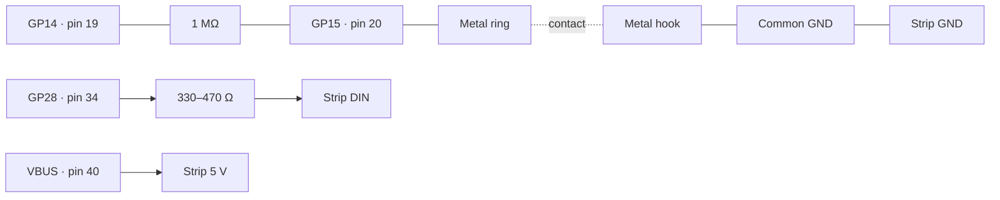

# A tiny computer judging your performance.

**Ring the Bull** adds an electronic scorekeeper to the pub game of swinging a metal ring onto a hook. A Raspberry Pi Pico W senses the grab, release, landing, and re-catch. You get 21 throws. It keeps the receipts.

The Pico runs the game, drives an LED score strip, and serves a phone scoreboard over local Wi-Fi. No cloud connection or app install is needed to play.

[Demo & screenshots](#demo--screenshots) · [Gameplay](#21-shot-gameplay) · [Build it](#pico-w-wiring) · [Setup](#setup--firmware-deployment) · [API](#api) · [Roadmap](#roadmap)

## Demo & screenshots

<table>
  <tr>
    <td align="center" valign="top" width="50%">
      <br>
      <sub>The installed build, photographed with its roughly 22-pixel score strip connected.</sub>
    </td>
    <td align="center" valign="top" width="50%">
      <br>
      <sub>Actual page served by the Pico over the local network. The QR points to that device's local address.</sub>
    </td>
  </tr>
</table>

**Try the separate [manual phone scorekeeper](https://mampersat.com/ringthebull/).** It uses HIT / MISS buttons and works without the electronics. The hardware scoreboard is served by your own Pico on your LAN; there is no public hardware demo or recorded demo video in this repo.

<details>
<summary>More build photos and the manual app</summary>

<p align="center">
  
  
  
</p>

</details>

## What works today

- **Automatic scoring:** capacitive grab/release sensing plus electrical ring-to-hook contact. A re-catch or three-second timeout records a miss.
- **21-shot games:** completion waits for the final result. The next physical grab/release starts a new game automatically; no web reset is needed.
- **Phone scoreboard:** a compact 7×3 history grid, shots left, hits/misses, current action/state, high score, best streak, and accuracy.
- **Undo and Start Over:** undo corrects the latest resolved throw and records; reset keeps records. A physical triple-tap gesture also resets the game.
- **Share:** completed scores become a green/red emoji grid plus the device URL. Native sharing falls back to copying or a manual copy prompt.
- **Persistent records:** best completed 21-shot score and longest hit streak within one game. No streak carries across games.
- **LED feedback:** score history, live touch intensity, flight indication, hook feedback, and an idle attract animation.
- **Offline scoring:** Wi-Fi failure does not wait for a connection or stop the game loop. The page, QR generator, and assets are served locally.

**Verification:** deployed on Pico W with MicroPython 1.29.0. Host and browser tests cover scoring, records, controls, mobile layout, sharing, and QR decoding. On-device synthetic checks cover completion, undo, reset, record reload, and scoring with Wi-Fi disabled; LAN checks cover the page and API. Earlier bench checks reported sensor `TIMEOUT` with the LEDs disconnected; physical throws and LED output still need documented validation on the wired rig.

## 21-shot gameplay

1. **Grab the ring.** Body capacitance tells the Pico you're holding it.
2. **Swing and release.** The throw counter advances; its block stays pending until the result arrives.
3. **Land it or catch it.** A confirmed hook contact scores a hit. Re-catching the ring scores a miss; a three-second timeout is the fallback.
4. **Finish throw 21, then keep playing.** Its result finalizes the game and records. The next grab/release starts a fresh game, and that release counts as shot 1.

The grid is green for hits, red for misses, and gray for pending throws. An outlined pending block marks the ring in flight. Shots left counts unresolved throws; accuracy uses hits divided by throws started.

The final card stays visible until the next throw starts. **Share last game** keeps its emoji result available during the next game and after reset. Only the latest completed card is shared; that archive is RAM-only and clears on reboot.

**Undo** is available between throws, including after completion. It removes the latest resolved throw and waits for ring release before resuming. Before the next game starts, undoing shot 21 reopens the completed card and corrects its records/archive; once the next game has started, undo applies to that game. It is unavailable during flight or with an empty history. **Start Over** asks for confirmation, clears the current game, and preserves records.

For a phone-free reset, touch the ring to the hook **three times within two seconds**, with at least 150 ms of contact and 150 ms of separation per tap. This is disabled during flight. The strip flashes white three times, then the game waits for release. Web controls skip that blocking flash.

### LED language

| Display | Meaning |
|---|---|
| Purple, variable brightness | Live capacitance at the next throw's location |
| Blue | Ring in flight |
| Green / red | Resolved hit / miss |
| Blinking white | Ring still on the hook after a landing |
| Red / white / blue sweep | Attract mode at boot, after reset, or after five minutes in eligible idle states |

### Records that survive the next round

`records.json` stores the best **completed** score and longest consecutive hit streak within one game. Streaks update on screen immediately; flash checkpoints happen on completion, reset, or undo, only when record values change. An unfinished game's streak is retained when you reset. Undo can retract a current-game record without losing earlier games' records.

Saves run outside active throw sensing, using a flushed temporary file and atomic rename on Pico LittleFS. Failed saves show an error and retry after 30 seconds in a safe state. Uncheckpointed streak gains can be lost on power-off. Reboot preserves records but starts a fresh game with no undo or completed-card history.

## Pico W wiring

You need a Pico W, conductive ring and hook, cord, a **1 MΩ resistor**, wiring, and USB power. LED feedback uses a WS2812-compatible strip with common ground.

| Pico connection | Physical pin | Wire to |
|---|---|---|
| GP14 | 19 | One end of the 1 MΩ resistor |
| GP15 | 20 | Other resistor end and metal ring |
| GND | e.g. 38 | Metal hook and strip ground |
| GP28 | 34 | Strip **DIN**, preferably through 330–470 Ω |
| VBUS | 40 | Strip 5 V from USB |
| Onboard LED | Internal | Five boot blinks; then raw ring-to-hook contact |



GPIO numbers are not physical pin numbers. Power the strip from **VBUS, not 3V3**, and keep its load within the USB supply and Pico power path. A 74AHCT125-style level shifter may be needed for 5 V strip data. Keep ring/hook sensing wires away from higher voltages.

The installed strip is roughly 22 pixels. Firmware currently allocates **100** (`PIXEL_COUNT`), uses **22** score/attract positions, and sets scoring brightness to **0.07**. Check the constants and actual power supply before changing strip length or brightness.

### How the ring becomes a sensor

GP14 charges GP15 through the resistor after a 10 ms discharge. Holding the ring adds body capacitance and increases charge time. Installed-wiring measurements were **52–117 µs untouched** and roughly **1,100–6,000 µs held**. These are relative timings, not farads.

The firmware uses **500 µs grab / 300 µs release** thresholds with debounce. For hook detection, GP15 briefly becomes a pulled-up input: touching the grounded hook pulls it low. Contact must persist for **300 ms** to count as hooked; removal takes **100 ms**. Hook detection wins over re-catch detection.

## Setup & firmware deployment

1. Install [MicroPython for Pico W](https://micropython.org/download/RPI_PICO_W/): hold BOOTSEL while connecting USB, then copy the UF2 to the mounted device.
2. Wire the rig and copy the three firmware modules below. `main.py` runs at boot.
3. For the phone UI, create a local, gitignored `wifi_config.py`:

   ```python
   WIFI_SSID = "your-network"
   WIFI_PASSWORD = "your-password"
   ```

**USB-only installations:** the commands below install the game directly. If OTA
is already installed, use its release tools instead: copying application `main.py`
to root would overwrite the recovery launcher.

Deploy from the repository root using [mpremote](https://docs.micropython.org/en/latest/reference/mpremote.html):

```sh
mpremote cp records.py :records.py
mpremote cp web_server.py :web_server.py
mpremote cp main.py :main.py
mpremote cp wifi_config.py :wifi_config.py  # optional Wi-Fi credentials
mpremote reset
```

The existing development setup also uses `ampy` over `/dev/ttyACM0`:

```sh
ampy --port /dev/ttyACM0 put records.py /records.py
ampy --port /dev/ttyACM0 put web_server.py /web_server.py
ampy --port /dev/ttyACM0 put main.py /main.py
ampy --port /dev/ttyACM0 put wifi_config.py /wifi_config.py  # optional
ampy --port /dev/ttyACM0 reset
```

Use your device's actual serial port. Keep `records.json` on the Pico when updating firmware to preserve records. For offline-only play, omit credentials; the web module itself is optional. Existing station/DHCP configuration is reused without a static IP change.

### Open the web UI

Connect the phone to the same network and open **http://ringthebull.local/**. Firmware sets `network.hostname('ringthebull')` before Wi-Fi initialization and uses MicroPython's built-in mDNS support; no extra responder or firmware reflash is needed. Host mDNS resolution and HTTP were verified on Pico W / MicroPython 1.29.0. Phone resolution still needs confirmation.

If your client or network does not support mDNS, use the DHCP IP instead. The serial console prints `Scoreboard: http://<DHCP-IP>/` when the listener starts; your router's DHCP leases also show the address. Scan the QR to bring another phone to the same local page. After changing the hostname, use a hard reset/power cycle so it applies on a fresh connection (`ampy --port /dev/ttyACM0 reset --hard`).

The self-contained page is about **29 KB**. It polls `/status` **500 ms after each request finishes**. The QR is generated once in the browser from `location.origin`; sharing uses that same origin, so neither depends on a hardcoded device address.

Networking uses `select.poll(0)`, nonblocking sockets, two client slots, bounded 512-byte reads/writes, and a five-second client timeout. Connection loss closes clients; the listener restarts after reconnection. Network initialization failures leave scoring running offline. There is no Wi-Fi setup portal or cloud relay.

### Browser fanfare

Shipped over Wi-Fi as **2026.11.09.6**, with restart/trial confirmation and preserved
records/results. Includes the fixed diagnostics layout and staging-noise fix. The
initial compatibility transfer used the signed bridge described below; no USB was
needed. Reload the Pico page after updating to load the new browser audio code.

Open **Soundboard** and tap **Enable Sound**. Each successful hit advances the
approved 15-hit synthesized brass/timpani sequence; misses stay silent and do not
advance it. Hits 1–4 play C / G / high C / E-to-E-flat; 5–8 reverse the last change;
9–12 end E-to-F. Hits 4, 8 and 12 have eight early low C/G drum beats. Hit 13 is
F major with drums, 14 G major, and 15 the big C-major/timpani finale. Hits above
15 stay silent until the next game; a miss on shot 21 never triggers a celebration.

**Test Next Hit**, **Restart Test**, and **Test Finale** audition it without changing
scores. The standalone design preview is `tools/soundboard_preview.html`. All audio
is generated locally in the browser with no recordings, voice services or external
assets. Sound is off on load; keep the browser open. Each enabled browser plays
independently, and phone sleep can stop audio. First load, reconnect, undo/reset,
and stale responses do not replay old results. Slow polling plays only the newest
result. The Pico publishes a small per-boot event counter/type; it does no audio
processing and needs no speaker for this version. Physical game behavior is unchanged.

### Live sensor diagnostics

Use **Enter Debug / Exit Debug** below the scoreboard. Debug shows raw RC charge
time, an observed idle baseline, delta, the fixed grab threshold, confirmed grabbed
state, and raw electrical hook contact. The canvas plots raw, baseline and threshold
for the last 60 seconds. All readings are in microseconds, not farads.

The browser requests `/debug` at up to 5 Hz, with one request in flight, and stops
when debug closes or the page is hidden. Its graph holds at most 300 samples;
the Pico stores no graph history and performs no extra sensor reads or flash writes.
The baseline is a diagnostic-only smoothed estimate from existing released samples
at/below the release threshold while READY, WAIT RELEASE or WAIT RESET. It starts
unknown, survives game resets in RAM, and never changes fixed scoring thresholds.
Raw/delta are `null` on timeout or when capacitance sensing is skipped on the hook;
the graph leaves gaps. Grabbed reflects confirmed HELD state (including a completed
game's held re-catch), not a single threshold crossing.

### Calibrate and troubleshoot

Open an ANSI-capable USB serial terminal (`mpremote connect`, `screen`, or minicom) for the live dashboard. It shows sensor timing, contact, state, counts, timeout, reset taps, and the last event.

- **Tune on the actual wiring.** Compare untouched and held readings, then adjust `GRAB_THRESHOLD` / `RELEASE_THRESHOLD` in `main.py`. Moving wires or nearby metal can shift the baseline.
- **`TIMEOUT` means no charge within 20 ms.** Check the resistor and ring wiring; it is not a valid low-capacitance reading.
- **Strip check:** `mpremote run test_neopixel.py`. This standalone test is configured for 100 pixels.
- **Capacitance diagnostic:** `diag_capacitance.py` visualizes/logs readings, but its 60/45 µs thresholds and bar scale are older than the game's current calibration.
- **Logging is currently enabled** (`LOG_ENABLED = True`). Pull `game_log.csv` with `mpremote cp :game_log.csv .`; disable logging for normal use if you don't need it. The logger stops below 150 KB free flash.

## Application OTA updates

**Bench verified 2026-11-09:** `2026.11.09.4` installed over Wi-Fi, rebooted and
confirmed; an authenticated deliberately stalled trial triggered the real hardware
watchdog and automatically rolled back to the confirmed release. High score 15,
best streak 7, and game results survived. All original device files were downloaded
and hash-verified under private `device_backups/ring-1794278043/`; only the archived
119 KB `readings.csv` diagnostic capture was removed with explicit approval.
Sensors were disconnected: physical throw sensing, LED output and physical
brownouts remain rig tests. Desktop tests cover interrupted downloads/pointer writes,
corruption, authentication, rollback, offline confirmation and scoring gates.

OTA is a local-LAN application updater, not a MicroPython firmware updater. The
repo is the release source; the Pico downloads signed, immutable releases from a
small server on your computer. Internet and that server are never required to
boot, sense the ring, or score. Existing USB-only installations continue working.

One-time setup (existing `ampy`, no new tools):

```sh
# Use this computer's actual LAN IPv4 address; reserve it in DHCP.
python3 tools/ota_release.py init --host 192.168.1.145
python3 tools/ota_release.py build --version 2026.11.09.1
python3 tools/ota_release.py serve
# In a separate terminal, with the ring released and no unfinished game:
python3 tools/ota_install.py --version 2026.11.09.bootstrap
# Add --bench ONLY for an explicitly disconnected-sensor bench board.
```

The installer is intentionally pinned to the verified Ring the Bull USB identity
`e66428c51fa06e28`; it refuses other boards and active/unconfirmed sensor states.
The optional `--bench` allowance accepts unavailable sensors only with an empty
game; it is displayed in update status and automatically disabled when valid
sensing appears (persisted at the next safe interval). Held/in-flight/unfinished
games remain blocked. It preserves the RAM game result before replacing the root entrypoint, backs up
deployed files to a private `/tmp/ring-ota-bootstrap-*` directory, verifies uploads,
and resets. Those host backups are temporary: copy them somewhere durable.
Do not run it against an already initialized OTA installation.

Open **Application updates** on the Pico page. Check/Install asks for the private
`key` from local gitignored `ota_config.json`; it is sent in a header and kept only
in page memory. Never publish that file or place it inside `releases/`. The same
per-device key authenticates the release manifest with HMAC-SHA-256. Plain HTTP
provides no confidentiality: use only a trusted LAN, never port-forward this API,
and keep the publisher directory separate from credentials. The Python release
server runs in the foreground until stopped; it is not installed as a service.

For subsequent deployments, change the application, run tests, build a **new**
version with `tools/ota_release.py build --version VERSION`, and use Check/Install.
Keep the server running on the configured IPv4/port (default 8765). Build reads the
current checkout, including uncommitted changes; a version is a named snapshot,
not proof that the files were committed. Existing version directories are immutable.
No Git client, GitHub API, DNS, HTTPS, or third-party updater runs on the Pico.

The allowed release set is only `main.py`, `web_server.py`, and `records.py`.
Manifest format 1 wraps an exact JSON `payload` string and its hexadecimal `hmac`;
payload contains `format`, `version`, and `files` (`name`, `size`, `sha256`). The
client rejects unexpected paths, oversized files/manifests, and encoded responses.
Downloads use numeric IPv4, nonblocking sockets, poll(0), and at most one 512-byte
network read/write per game-loop pass. Files stream to the inactive slot, are
hashed as written, closed/synced, re-read and hashed from flash in bounded chunks,
then activated together by a LittleFS atomic
pointer replacement. Restarted/interrupted transfers begin at byte zero; this
version does not use HTTP Range/resume offsets. Bad or partial slots never boot.

Checks and installation require an empty or completed game and a released ring.
Staging follows confirmed game state, tolerating isolated unconfirmed capacitance
spikes. A confirmed grab, hook contact, timeout/unavailable sample, or unfinished
game pauses it. A fully verified release waits for a released ring and cleared
grab candidate before activation; it does not restart the download for a brief
candidate. Check/Install can be retried when safe. Activation briefly restarts
the Pico, so sensing is unavailable during that restart. Flash operations can add
latency even though sockets never block. They run only between games.

`ota/launcher.py` is installed once as root `/main.py`. Root `ota_recovery.py` and
`ota_client.py`, private configuration, `records.json`, logs, and OTA metadata stay
outside slots `ota_a/` and `ota_b/`; ordinary releases cannot overwrite them. Game
results and the record baseline are checkpointed before activation and restored
on a trial or rollback, including the last shareable result and undo context.
This is an update checkpoint, not continuous persistence of every throw.

Before executing a candidate, recovery persists an unconfirmed trial marker. A
restart/power loss before confirmation selects the previous slot. Exceptions
reset immediately; an 8-second hardware watchdog recovers a stalled loop. After
30 seconds and at least 30 completed loop passes, confirmation waits for a safe
released state; it does not require Wi-Fi. The watchdog remains enabled after
confirmation. It affects serial maintenance: stopping the loop can reset the board.
Recovery-module changes require USB maintenance, not an application release.
`python3 tools/ota_maintenance.py enter` sets a USB-only maintenance marker and
resets into REPL with the watchdog disabled. Use existing ampy there for repairs;
`python3 tools/ota_maintenance.py exit` removes the marker and restarts the game.
This deliberately suspends scoring: use only during supervised maintenance.

An open append log can make LittleFS free-space reporting count shared blocks
more than once. The updater flushes/closes logging between games while checking
or staging, then resumes logging on completion/error/pause. Existing log data is
never deleted automatically. If space is insufficient, archive/verify old captures
before explicitly deciding what to remove. Never bypass the capacity check.

For a controlled end-to-end check between games/on a bench, use
`python3 tools/ota_verify.py --version VERSION`. It checks authentication, installs
the served release, waits for trial confirmation, and compares records/results.

Two copies need free flash; staging checks capacity with a margin. Atomic pointer
safety assumes the standard Pico MicroPython LittleFS filesystem and working flash;
a damaged filesystem or corrupted recovery code still needs USB recovery. Automated
host failure injection cannot prove physical brownout behavior, RF reconnection,
flash latency, or watchdog timing on every rig. Trial confirmation catches startup
failures and loop stalls, not every possible scoring regression.

## API

Plain HTTP on the Pico's local address. Responses are uncached. Mutations take an **empty POST body**; GET never changes the game.

| Method | Path | Response / behavior |
|---|---|---|
| GET | `/` | Mobile scoreboard and inline QR generator |
| GET | `/status` | JSON snapshot of game state and records |
| GET | `/debug` | Small read-only sensor snapshot: `raw`, `baseline`, `delta`, `grab_threshold`, `release_threshold`, `grabbed`, `hook_contact` |
| GET | `/ota/status` | Installed/available version, update state/error/progress, trial flag |
| POST | `/ota/check`, `/ota/install` | Empty body and `X-OTA-Key` required; `403` unauthorized, `409` busy/active game |
| GET | `/health` | `200` with `ok` and a newline |
| POST | `/undo` | Updated snapshot; `409` during flight or with no history |
| POST | `/reset` | Updated snapshot; clears game, preserves records |

`/status` fields:

| Field | Meaning |
|---|---|
| `score_boot`, `score_event`, `score_sound` | Per-boot resolved-score notification for browser audio; counter/type only, no audio data |
| `throws`, `hits`, `misses` | Started throws and resolved results; during flight, results can total one less than throws |
| `history` | Ordered booleans: `true` hit, `false` miss; at most 21 |
| `state` | `READY`, `HELD`, `IN FLIGHT`, `LANDED`, `WAIT RESET`, `WAIT RELEASE`, or `COMPLETE` |
| `hook` | Raw electrical contact, before debounce |
| `complete`, `can_undo` | Whether the current card has 21 resolved results, and current undo availability |
| `last_completed` | Latest completed card (`throws`, `hits`, `misses`, `history`), or `null`; retained across rollover/reset, corrected by undo |
| `best`, `longest_streak` | Best completed score and longest streak, including the current game's applicable contribution |
| `records_error` | Storage error message, or `null` |
| `uptime` | Seconds since web-server initialization; game reset does not reset it |

POST snapshots contain the same game/record fields without `uptime`. Nonempty POST bodies return `400`; unsupported methods return `405`. A supplied `Origin` must match the HTTP `Host`, otherwise mutation returns `403`. The API has no authentication.

```sh
# Replace with the address printed by your Pico.
PICO_URL=http://192.168.1.143
curl "$PICO_URL/status"
curl "$PICO_URL/health"
curl -X POST "$PICO_URL/undo"
# Starts a fresh game; curl does not show the browser's confirmation dialog.
curl -X POST "$PICO_URL/reset"
```

## Development & checks

| File | Role |
|---|---|
| `main.py` | Sensors, game state machine, LEDs, reset, and serial dashboard |
| `records.py` | Record computation and atomic checkpoints |
| `web_server.py` | Nonblocking HTTP and embedded mobile UI |
| `tests/` | Host, browser, and synthetic Pico checks |
| `index.html`, `sw.js`, `manifest.json`, `vendor/`, `icons/` | Separate manual phone PWA |
| `deploy.sh`, `scripts/` | S3/CloudFront deployment and manual-app screenshot tooling |

```sh
python3 -m unittest discover -s tests -v
# Browser tests use Chrome and the existing Puppeteer dependency:
(cd scripts && npm ci)
node tests/test_scoreboard.js
# Synthetic hardware check; interrupts gameplay, uses isolated test records:
ampy --port /dev/ttyACM0 run tests/pico_games.py
ampy --port /dev/ttyACM0 reset
```

Synthetic checks do not replace physical throws. Remaining hardware checks include changed wiring/calibration, disconnected LEDs, unavailable Wi-Fi, reconnect behavior, and sensing under slow HTTP clients. Mobile viewport and share fallbacks are browser-tested; native phone sharing still depends on browser support.

### Deploy the separate manual PWA

Open `index.html` locally to use the manual scorekeeper. It has 21-shot games, undo, local score history, sharing, and QR-based history transfer. Its existing screenshot is shown above.

From the repository root, `./deploy.sh` uploads the HTML and PWA assets to `s3://mampersat.com/ringthebull/`, requests a CloudFront invalidation for `/ringthebull/*`, and regenerates `images/screenshot.png` locally. It requires configured AWS CLI access, Node/npm, and Chrome/Chromium (`CHROME_PATH` can override the binary). The footer is stamped with the Git commit hash. This command publishes the manual app; Pico firmware uses USB deployment separately.

Related Android project: [mampersat/RingingTheBull](https://github.com/mampersat/RingingTheBull).

## Roadmap

The working scorer is the starting point. These are product directions to explore, not released kits or promised specifications.

| Direction | Next step |
|---|---|
| **Founder's Edition** | Turn the wall-mounted build into a repeatable, documented kit with a finished enclosure and installation guide. |
| **Tabletop Mini** | Explore a smaller tabletop version and validate sensing on its shorter ring travel. |
| **$10 clip-on** | Explore an add-on scorer for an existing game. **$10 is a target**, not a verified build cost or sale price. |

Other open work: adaptive calibration, multiplayer, and fuller physical validation. Weekly streaks are deferred until there is a reliable synchronized clock. The Pico currently has no such clock setup; current game/undo history is RAM-only, and the three-second miss timeout can expire while a ring is still swinging.

### Legacy sensing-gate compatibility release

`tools/ota_guard_bridge.py` builds a one-time, roughly 2.6 KB signed application
release for installed version `2026.11.09.4`, whose staging gate cancels on single
raw spikes. Use quiet desktop polling (`tools/ota_verify.py --poll-interval 5`) for
that transfer. It is not an unauthenticated override and keeps the hook/game gates.
During trial boot, the bridge checks embedded hashes of all previous-slot source
files, expands an independent copy into its own slot, and changes only the OTA
gate/poll code. Expanded outputs are also hash-checked. Any interrupted expansion
rolls back to the untouched previous slot; confirmation still requires normal loop
progress and a safe state. Once confirmed, a normal full release can overwrite the
previous slot safely. The launcher, updater, credentials, logs and records stay
outside this application-only migration. Its signed transport files are loaders;
their expected expanded hashes are embedded in that loader, rather than matching
the small transport sizes. Normal releases continue to use ordinary file hashes.
