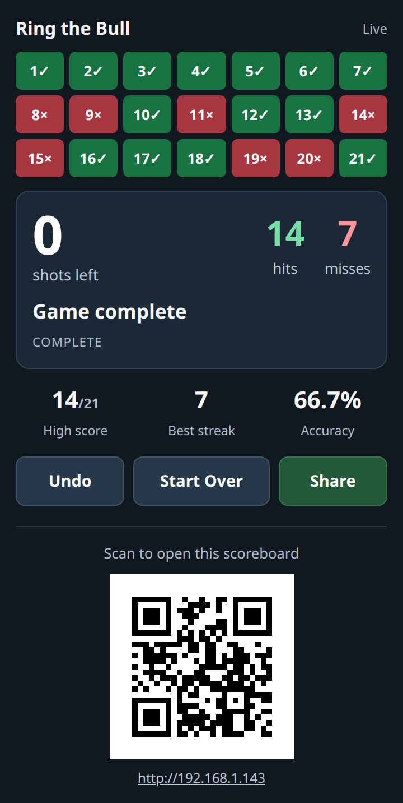
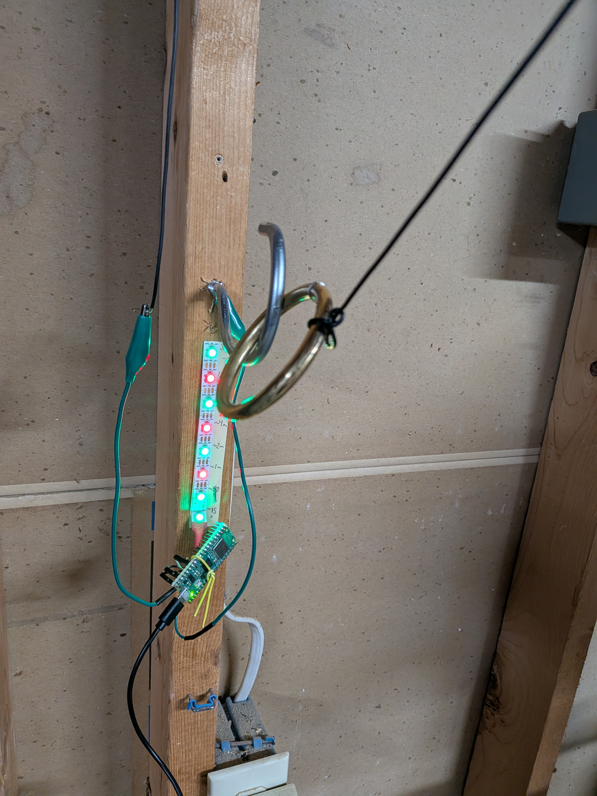
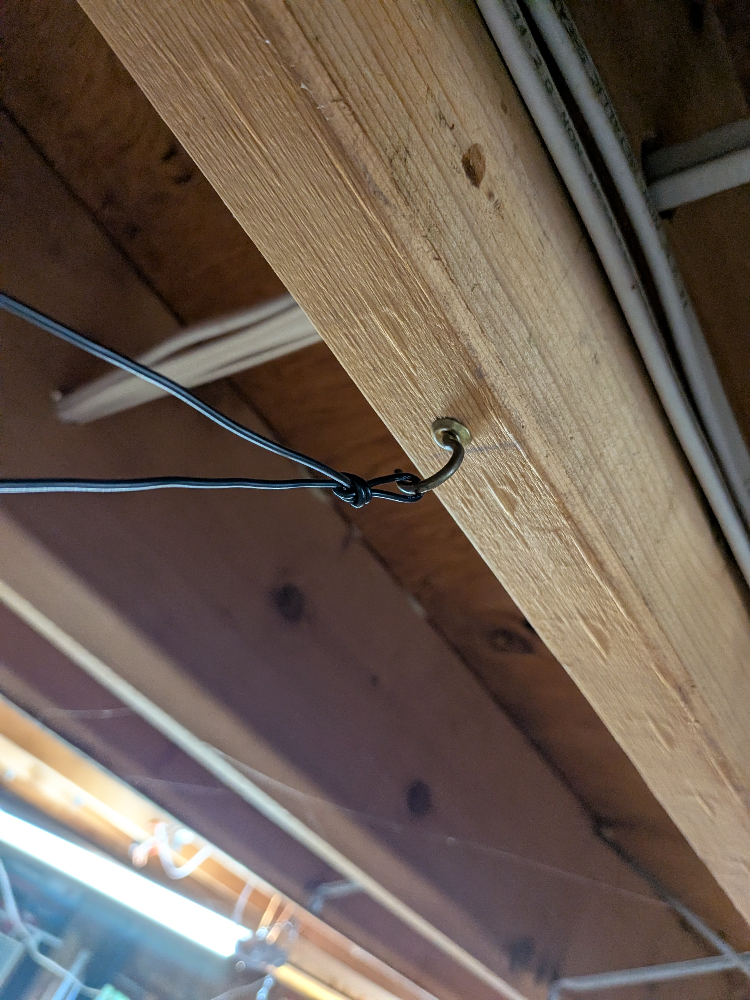
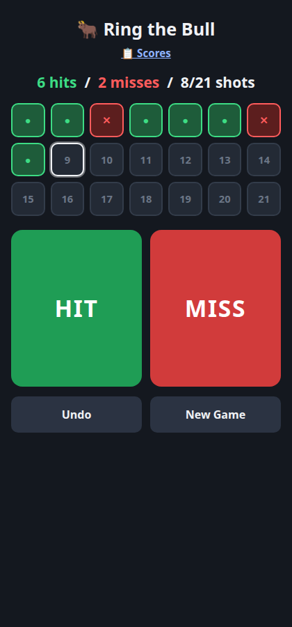
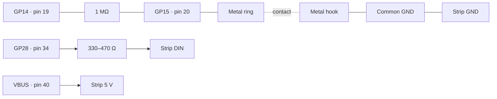

# A tiny computer judging your performance.

**Ring the Bull** adds an electronic scorekeeper to the pub game of swinging a metal ring onto a hook. A Raspberry Pi Pico W senses the grab, release, landing, and re-catch. You get 21 throws. It keeps the receipts.

The Pico runs the game, drives an LED score strip, and serves a phone scoreboard over local Wi-Fi. No cloud connection or app install is needed to play.

[Demo & screenshots](#demo--screenshots) · [Gameplay](#21-shot-gameplay) · [Build it](#pico-w-wiring) · [Setup](#setup--firmware-deployment) · [API](#api) · [Roadmap](#roadmap)

## Demo & screenshots

<table>
  <tr>
    <td align="center" valign="top" width="50%">
      <br>
      <sub>The installed build, photographed with its roughly 22-pixel score strip connected.</sub>
    </td>
    <td align="center" valign="top" width="50%">
      <br>
      <sub>Actual page served by the Pico over the local network. The QR points to that device's local address.</sub>
    </td>
  </tr>
</table>

**Try the separate [manual phone scorekeeper](https://mampersat.com/ringthebull/).** It uses HIT / MISS buttons and works without the electronics. The hardware scoreboard is served by your own Pico on your LAN; there is no public hardware demo or recorded demo video in this repo.

<details>
<summary>More build photos and the manual app</summary>

<p align="center">
  
  
  
</p>

</details>

## What works today

- **Automatic scoring:** capacitive grab/release sensing plus electrical ring-to-hook contact. A re-catch or three-second timeout records a miss.
- **21-shot games:** completion waits for the final result. The next physical grab/release starts a new game automatically; no web reset is needed.
- **Phone scoreboard:** a compact 7×3 history grid, shots left, hits/misses, current action/state, high score, best streak, and accuracy.
- **Undo and Start Over:** undo corrects the latest resolved throw and records; reset keeps records. A physical triple-tap gesture also resets the game.
- **Share:** completed scores become a green/red emoji grid plus the device URL. Native sharing falls back to copying or a manual copy prompt.
- **Persistent records:** best completed 21-shot score and longest hit streak within one game. No streak carries across games.
- **LED feedback:** score history, live touch intensity, flight indication, hook feedback, and an idle attract animation.
- **Offline scoring:** Wi-Fi failure does not wait for a connection or stop the game loop. The page, QR generator, and assets are served locally.

**Verification:** deployed on Pico W with MicroPython 1.29.0. Host and browser tests cover scoring, records, controls, mobile layout, sharing, and QR decoding. On-device synthetic checks cover completion, undo, reset, record reload, and scoring with Wi-Fi disabled; LAN checks cover the page and API. Earlier bench checks reported sensor `TIMEOUT` with the LEDs disconnected; physical throws and LED output still need documented validation on the wired rig.

## 21-shot gameplay

1. **Grab the ring.** Body capacitance tells the Pico you're holding it.
2. **Swing and release.** The throw counter advances; its block stays pending until the result arrives.
3. **Land it or catch it.** A confirmed hook contact scores a hit. Re-catching the ring scores a miss; a three-second timeout is the fallback.
4. **Finish throw 21, then keep playing.** Its result finalizes the game and records. The next grab/release starts a fresh game, and that release counts as shot 1.

The grid is green for hits, red for misses, and gray for pending throws. An outlined pending block marks the ring in flight. Shots left counts unresolved throws; accuracy uses hits divided by throws started.

The final card stays visible until the next throw starts. **Share last game** keeps its emoji result available during the next game and after reset. Only the latest completed card is shared; that archive is RAM-only and clears on reboot.

**Undo** is available between throws, including after completion. It removes the latest resolved throw and waits for ring release before resuming. Before the next game starts, undoing shot 21 reopens the completed card and corrects its records/archive; once the next game has started, undo applies to that game. It is unavailable during flight or with an empty history. **Start Over** asks for confirmation, clears the current game, and preserves records.

For a phone-free reset, touch the ring to the hook **three times within two seconds**, with at least 150 ms of contact and 150 ms of separation per tap. This is disabled during flight. The strip flashes white three times, then the game waits for release. Web controls skip that blocking flash.

### LED language

| Display | Meaning |
|---|---|
| Purple, variable brightness | Live capacitance at the next throw's location |
| Blue | Ring in flight |
| Green / red | Resolved hit / miss |
| Blinking white | Ring still on the hook after a landing |
| Red / white / blue sweep | Attract mode at boot, after reset, or after five minutes in eligible idle states |

### Records that survive the next round

`records.json` stores the best **completed** score and longest consecutive hit streak within one game. Streaks update on screen immediately; flash checkpoints happen on completion, reset, or undo, only when record values change. An unfinished game's streak is retained when you reset. Undo can retract a current-game record without losing earlier games' records.

Saves run outside active throw sensing, using a flushed temporary file and atomic rename on Pico LittleFS. Failed saves show an error and retry after 30 seconds in a safe state. Uncheckpointed streak gains can be lost on power-off. Reboot preserves records but starts a fresh game with no undo or completed-card history.

## Pico W wiring

You need a Pico W, conductive ring and hook, cord, a **1 MΩ resistor**, wiring, and USB power. LED feedback uses a WS2812-compatible strip with common ground.

| Pico connection | Physical pin | Wire to |
|---|---|---|
| GP14 | 19 | One end of the 1 MΩ resistor |
| GP15 | 20 | Other resistor end and metal ring |
| GND | e.g. 38 | Metal hook and strip ground |
| GP28 | 34 | Strip **DIN**, preferably through 330–470 Ω |
| VBUS | 40 | Strip 5 V from USB |
| Onboard LED | Internal | Five boot blinks; then raw ring-to-hook contact |



GPIO numbers are not physical pin numbers. Power the strip from **VBUS, not 3V3**, and keep its load within the USB supply and Pico power path. A 74AHCT125-style level shifter may be needed for 5 V strip data. Keep ring/hook sensing wires away from higher voltages.

The installed strip is roughly 22 pixels. Firmware currently allocates **100** (`PIXEL_COUNT`), uses **22** score/attract positions, and sets scoring brightness to **0.07**. Check the constants and actual power supply before changing strip length or brightness.

### How the ring becomes a sensor

GP14 charges GP15 through the resistor after a 10 ms discharge. Holding the ring adds body capacitance and increases charge time. Installed-wiring measurements were **52–117 µs untouched** and roughly **1,100–6,000 µs held**. These are relative timings, not farads.

The firmware uses **500 µs grab / 300 µs release** thresholds with debounce. For hook detection, GP15 briefly becomes a pulled-up input: touching the grounded hook pulls it low. Contact must persist for **300 ms** to count as hooked; removal takes **100 ms**. Hook detection wins over re-catch detection.

## Setup & firmware deployment

1. Install [MicroPython for Pico W](https://micropython.org/download/RPI_PICO_W/): hold BOOTSEL while connecting USB, then copy the UF2 to the mounted device.
2. Wire the rig and copy the three firmware modules below. `main.py` runs at boot.
3. For the phone UI, create a local, gitignored `wifi_config.py`:

   ```python
   WIFI_SSID = "your-network"
   WIFI_PASSWORD = "your-password"
   ```

Deploy from the repository root using [mpremote](https://docs.micropython.org/en/latest/reference/mpremote.html):

```sh
mpremote cp records.py :records.py
mpremote cp web_server.py :web_server.py
mpremote cp main.py :main.py
mpremote cp wifi_config.py :wifi_config.py  # optional Wi-Fi credentials
mpremote reset
```

The existing development setup also uses `ampy` over `/dev/ttyACM0`:

```sh
ampy --port /dev/ttyACM0 put records.py /records.py
ampy --port /dev/ttyACM0 put web_server.py /web_server.py
ampy --port /dev/ttyACM0 put main.py /main.py
ampy --port /dev/ttyACM0 put wifi_config.py /wifi_config.py  # optional
ampy --port /dev/ttyACM0 reset
```

Use your device's actual serial port. Keep `records.json` on the Pico when updating firmware to preserve records. For offline-only play, omit credentials; the web module itself is optional. Existing station/DHCP configuration is reused without a static IP change.

### Open the web UI

Connect the phone to the same network and open **http://ringthebull.local/**. Firmware sets `network.hostname('ringthebull')` before Wi-Fi initialization and uses MicroPython's built-in mDNS support; no extra responder or firmware reflash is needed. Host mDNS resolution and HTTP were verified on Pico W / MicroPython 1.29.0. Phone resolution still needs confirmation.

If your client or network does not support mDNS, use the DHCP IP instead. The serial console prints `Scoreboard: http://<DHCP-IP>/` when the listener starts; your router's DHCP leases also show the address. Scan the QR to bring another phone to the same local page. After changing the hostname, use a hard reset/power cycle so it applies on a fresh connection (`ampy --port /dev/ttyACM0 reset --hard`).

The self-contained page is about **12 KB**. It polls `/status` **500 ms after each request finishes**. The QR is generated once in the browser from `location.origin`; sharing uses that same origin, so neither depends on a hardcoded device address.

Networking uses `select.poll(0)`, nonblocking sockets, two client slots, bounded 512-byte reads/writes, and a five-second client timeout. Connection loss closes clients; the listener restarts after reconnection. Network initialization failures leave scoring running offline. There is no Wi-Fi setup portal or cloud relay.

### Calibrate and troubleshoot

Open an ANSI-capable USB serial terminal (`mpremote connect`, `screen`, or minicom) for the live dashboard. It shows sensor timing, contact, state, counts, timeout, reset taps, and the last event.

- **Tune on the actual wiring.** Compare untouched and held readings, then adjust `GRAB_THRESHOLD` / `RELEASE_THRESHOLD` in `main.py`. Moving wires or nearby metal can shift the baseline.
- **`TIMEOUT` means no charge within 20 ms.** Check the resistor and ring wiring; it is not a valid low-capacitance reading.
- **Strip check:** `mpremote run test_neopixel.py`. This standalone test is configured for 100 pixels.
- **Capacitance diagnostic:** `diag_capacitance.py` visualizes/logs readings, but its 60/45 µs thresholds and bar scale are older than the game's current calibration.
- **Logging is currently enabled** (`LOG_ENABLED = True`). Pull `game_log.csv` with `mpremote cp :game_log.csv .`; disable logging for normal use if you don't need it. The logger stops below 150 KB free flash.

## API

Plain HTTP on the Pico's local address. Responses are uncached. Mutations take an **empty POST body**; GET never changes the game.

| Method | Path | Response / behavior |
|---|---|---|
| GET | `/` | Mobile scoreboard and inline QR generator |
| GET | `/status` | JSON snapshot of game state and records |
| GET | `/health` | `200` with `ok` and a newline |
| POST | `/undo` | Updated snapshot; `409` during flight or with no history |
| POST | `/reset` | Updated snapshot; clears game, preserves records |

`/status` fields:

| Field | Meaning |
|---|---|
| `throws`, `hits`, `misses` | Started throws and resolved results; during flight, results can total one less than throws |
| `history` | Ordered booleans: `true` hit, `false` miss; at most 21 |
| `state` | `READY`, `HELD`, `IN FLIGHT`, `LANDED`, `WAIT RESET`, `WAIT RELEASE`, or `COMPLETE` |
| `hook` | Raw electrical contact, before debounce |
| `complete`, `can_undo` | Whether the current card has 21 resolved results, and current undo availability |
| `last_completed` | Latest completed card (`throws`, `hits`, `misses`, `history`), or `null`; retained across rollover/reset, corrected by undo |
| `best`, `longest_streak` | Best completed score and longest streak, including the current game's applicable contribution |
| `records_error` | Storage error message, or `null` |
| `uptime` | Seconds since web-server initialization; game reset does not reset it |

POST snapshots contain the same game/record fields without `uptime`. Nonempty POST bodies return `400`; unsupported methods return `405`. A supplied `Origin` must match the HTTP `Host`, otherwise mutation returns `403`. The API has no authentication.

```sh
# Replace with the address printed by your Pico.
PICO_URL=http://192.168.1.143
curl "$PICO_URL/status"
curl "$PICO_URL/health"
curl -X POST "$PICO_URL/undo"
# Starts a fresh game; curl does not show the browser's confirmation dialog.
curl -X POST "$PICO_URL/reset"
```

## Development & checks

| File | Role |
|---|---|
| `main.py` | Sensors, game state machine, LEDs, reset, and serial dashboard |
| `records.py` | Record computation and atomic checkpoints |
| `web_server.py` | Nonblocking HTTP and embedded mobile UI |
| `tests/` | Host, browser, and synthetic Pico checks |
| `index.html`, `sw.js`, `manifest.json`, `vendor/`, `icons/` | Separate manual phone PWA |
| `deploy.sh`, `scripts/` | S3/CloudFront deployment and manual-app screenshot tooling |

```sh
python3 -m unittest discover -s tests -v
# Browser tests use Chrome and the existing Puppeteer dependency:
(cd scripts && npm ci)
node tests/test_scoreboard.js
# Synthetic hardware check; interrupts gameplay, uses isolated test records:
ampy --port /dev/ttyACM0 run tests/pico_games.py
ampy --port /dev/ttyACM0 reset
```

Synthetic checks do not replace physical throws. Remaining hardware checks include changed wiring/calibration, disconnected LEDs, unavailable Wi-Fi, reconnect behavior, and sensing under slow HTTP clients. Mobile viewport and share fallbacks are browser-tested; native phone sharing still depends on browser support.

### Deploy the separate manual PWA

Open `index.html` locally to use the manual scorekeeper. It has 21-shot games, undo, local score history, sharing, and QR-based history transfer. Its existing screenshot is shown above.

From the repository root, `./deploy.sh` uploads the HTML and PWA assets to `s3://mampersat.com/ringthebull/`, requests a CloudFront invalidation for `/ringthebull/*`, and regenerates `images/screenshot.png` locally. It requires configured AWS CLI access, Node/npm, and Chrome/Chromium (`CHROME_PATH` can override the binary). The footer is stamped with the Git commit hash. This command publishes the manual app; Pico firmware uses USB deployment separately.

Related Android project: [mampersat/RingingTheBull](https://github.com/mampersat/RingingTheBull).

## Roadmap

The working scorer is the starting point. These are product directions to explore, not released kits or promised specifications.

| Direction | Next step |
|---|---|
| **Founder's Edition** | Turn the wall-mounted build into a repeatable, documented kit with a finished enclosure and installation guide. |
| **Tabletop Mini** | Explore a smaller tabletop version and validate sensing on its shorter ring travel. |
| **$10 clip-on** | Explore an add-on scorer for an existing game. **$10 is a target**, not a verified build cost or sale price. |

Other open work: adaptive calibration, multiplayer, and fuller physical validation. Weekly streaks are deferred until there is a reliable synchronized clock. The Pico currently has no such clock setup; current game/undo history is RAM-only, and the three-second miss timeout can expire while a ring is still swinging.
