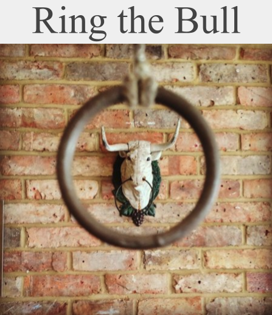
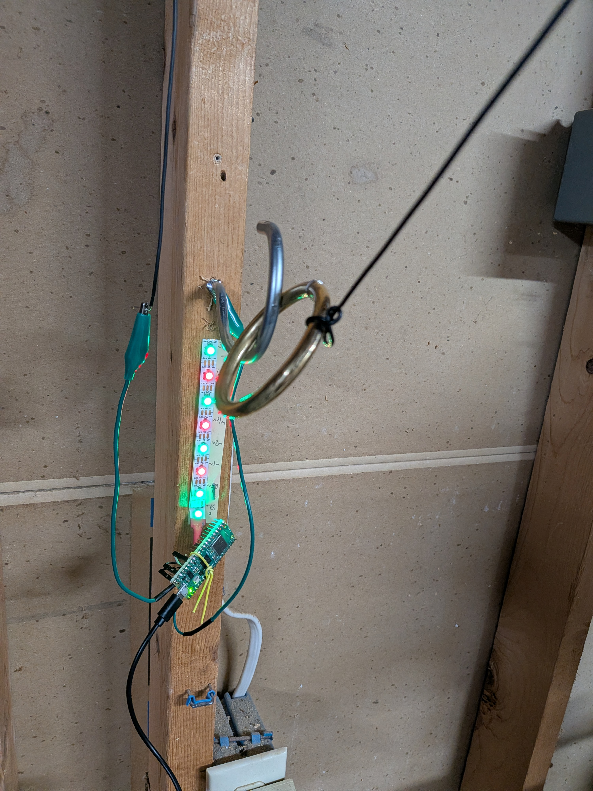
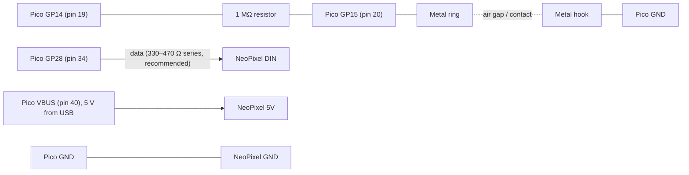
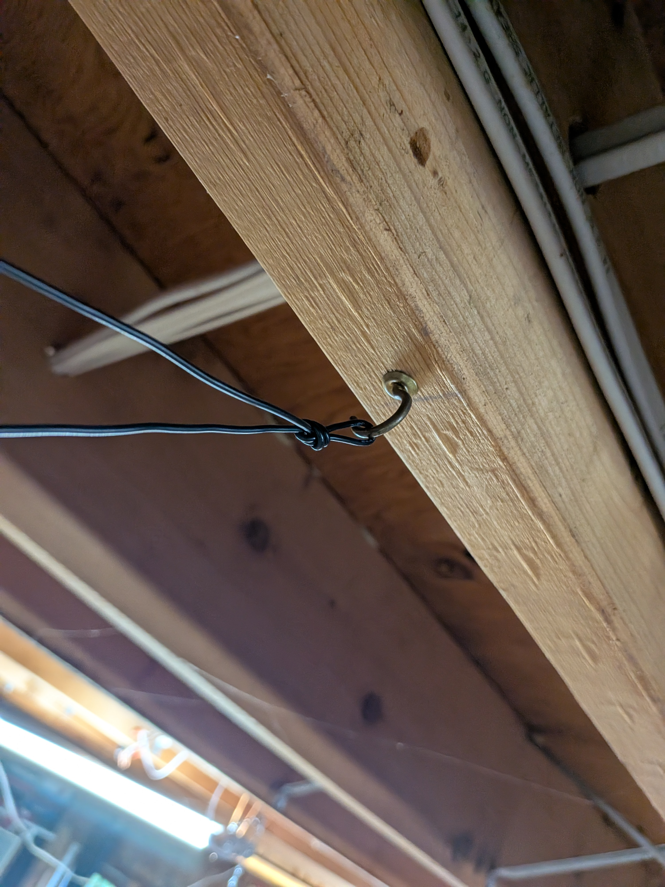
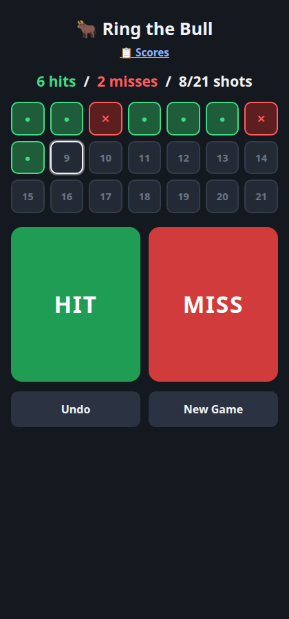

# Ring the Bull



**Ring the Bull** is a traditional pub game: swing a metal ring on a string and try to land it on a metal hook on the wall. This project adds an **electronic scorer**. A Raspberry Pi Pico W detects when you grab the ring, when you let go, and when the ring touches the hook, then keeps score and shows your throws on an LED strip.

There's also a simple phone [score-keeper web app](#phone-score-keeper-web-app) in this repo for playing without the electronics.

<p align="center"></p>

> **Status:** installed and working. Sensing, scoring, LED feedback, reset gesture and attract mode are implemented. More build photos and enclosure details are still to come.

## Features

- Detects **grab**, **release (throw)**, **hook** and **re-catch** automatically.
- Counts throws, hits and misses; a miss is recorded when you catch the returning ring, so play continues without pressing anything.
- NeoPixel strip shows the live state plus a green/red history of every throw.
- **Triple-tap reset**: touch the ring to the hook three times. No buttons.
- **Attract mode**: a slow red / white / blue sweep when nobody is playing.
- Nothing mounted on the hook, no moving switches: only one wire to the ring and one to the hook.
- Live serial dashboard for debugging and calibration.

## Hardware

| Part | Notes |
|---|---|
| Raspberry Pi Pico W (RP2040) | Runs MicroPython |
| WS2812-compatible NeoPixel strip | Firmware is configured for 100 pixels; the intended installation uses roughly 22 |
| 1 MΩ resistor | Capacitive sensing |
| Conductive metal ring | Connected to GP15 |
| Conductive metal hook | Connected to GND |
| Wire to ring and hook | Designed for around 12 ft to the ring |
| USB power source | Powers the Pico; the strip's 5 V is taken from the Pico's VBUS pin (pin 40) |
| 330–470 Ω resistor (recommended) | In series with the NeoPixel data line |
| 74AHCT125 level shifter (optional) | May be needed to drive 5 V strips from 3.3 V GPIO |

### Pico W pinout

| Pico GPIO | Physical pin | Purpose |
|---|---|---|
| GP14 | 19 | Capacitive sensor drive |
| GP15 | 20 | Capacitive sensor input and hook continuity (ring) |
| GP28 | 34 | NeoPixel data (DIN) |
| GND | e.g. 38 | Ground, hook connection, strip ground |
| VBUS | 40 | 5 V from USB; powers the NeoPixel strip |
| Onboard LED | internal | Lit when hooked; flashes on a timeout miss |

GPIO numbers and physical pin numbers differ. Check the board orientation before wiring.

### Wiring



All grounds must be common. Data goes into **DIN**, not DOUT. The strip's 5 V comes from the Pico's **VBUS** pin (pin 40), so it is powered from the USB supply. Do not use the 3V3 pin, and keep the strip's brightness and length within what the USB supply and the Pico's VBUS connection can handle.

## How sensing works

### Grab / release: capacitive sensing

No special sensor chip is used, just an RC charge-time measurement on two GPIOs:

1. Drive GP14 and GP15 low for ~10 ms to discharge everything.
2. Make GP15 a floating input and drive GP14 high.
3. Time how long GP15 takes to read high through the 1 MΩ resistor.

A person holding the metal ring adds capacitance, so the charge time gets longer. In the prototype:

| Condition | Typical reading |
|---|---|
| Ring untouched | 50–59 µs |
| Ring held | 90–100 µs |

The firmware treats ≥ 80 µs as a grab and ≤ 70 µs as a release. The gap is hysteresis to stop flicker. These numbers are a relative timing, not capacitance in farads, and came from the original prototype wiring.

### Hook: continuity

The hook is wired to ground. To check for contact, the firmware makes GP15 an input with the internal pull-up; if the ring touches the hook it reads LOW. The pins are then restored for capacitive sensing. Contact must last 300 ms to count as hooked (and 100 ms to count as removed).

## Installation

1. Install MicroPython for the Pico W from [micropython.org](https://micropython.org/download/RPI_PICO_W/) (hold BOOTSEL, plug in USB, copy the `.uf2`).
2. Wire the hardware as above.
3. Copy `main.py` to the Pico as `main.py`, for example with [mpremote](https://docs.micropython.org/en/latest/reference/mpremote.html):

   ```sh
   mpremote cp main.py :main.py
   mpremote reset
   ```

   Thonny works too. The script starts automatically on power-up.
4. Optional: `mpremote run test_neopixel.py` cycles the strip through red/green/blue to verify wiring.
5. Open a serial terminal to see the dashboard (below).

No network connection is used.

### Serial dashboard

Over USB serial the Pico draws an in-place text dashboard (~5 Hz): game state or attract mode, live charge time in µs, raw and debounced hook state, throws/hits/misses, time left before a throw times out, reset-tap progress, and the last event. It uses ANSI escape codes, so use a real terminal (`mpremote connect`, `screen`, minicom) rather than an IDE console that may not support them.

## How to play

1. Grab the ring. **Pixel 0** blinks red.
2. Swing and let go. Pixel 0 turns solid **blue** while the ring is in flight.
3. If the ring lands on the hook: **green**, and the onboard LED lights.
4. If it misses and you catch it again, the throw is scored as a miss and you're straight back to holding it.

Pixel 0 shows the current state; pixels 1, 2, 3 … show throw 1, 2, 3 …

| Colour | Meaning |
|---|---|
| Blinking red | Ring grabbed |
| Solid blue | Ring in flight |
| Green | Hit |
| Red | Miss |
| Off | Idle / unused |

Finished throws keep their red or green until reset. History wraps around once the strip is full.

If the ring is thrown and nothing happens for 3 seconds, a miss is recorded and the onboard LED flashes briefly.

## Resetting the game

Touch the ring to the hook **three separate times within two seconds** (each contact ≥ 50 ms with ≥ 50 ms between them). Works while holding the ring but not during a throw. Counts and history clear, the strip flashes white three times, and the system waits for you to let go of the ring before a new game starts.

## Attract mode

When idle the strip plays a slow animation along the first 22 pixels: a single soft point with dim neighbours travels 0 → 21 in red, then white, then blue, repeating (about 4 s per sweep, 12 s per cycle). It is much dimmer than the scoring display. It starts at boot, right after a reset, and after 5 minutes without activity. Any game activity cancels it.

## Configuration and calibration

Everything is a constant near the top of `main.py`:

| Constant | Default | Meaning |
|---|---|---|
| `GRAB_THRESHOLD` / `RELEASE_THRESHOLD` | 80 / 70 | Cap-sense µs thresholds |
| `PIXEL_COUNT` | 100 | Strip length in firmware |
| `BRIGHTNESS` | 0.15 | Scoring brightness |
| `THROW_TIMEOUT_MS` | 3000 | Fallback miss timeout |
| `ATTRACT_IDLE_MS` | 5 min | Idle time before attract mode |
| `ATTRACT_PIXELS` | 22 | Pixels used by the attract sweep |

**Calibrating:** thresholds are fixed, and a different wire length, routing or nearby grounded metal changes the baseline. With the dashboard open, note the reading with the ring untouched and with it held, then set `RELEASE_THRESHOLD` and `GRAB_THRESHOLD` between the two (grab above release, with a margin on each side). Re-check if the wiring moves.

## Build photos

<table>
  <tr>
    <td align="center" valign="top" width="50%">
      <br>
      <sub>The brass ring on the hook, with the LED strip showing throw history (green hits, red misses) and the Pico W mounted below on the same wooden upright.</sub>
    </td>
    <td align="center" valign="top" width="50%">
      <br>
      <sub>The cord the ring hangs from is tied to a brass cup hook screwed into a ceiling joist.</sub>
    </td>
  </tr>
</table>

## Known limitations and ideas

- Fixed thresholds; automatic baseline calibration and adaptive thresholds would help with long or moving wires.
- Wire movement and nearby grounded objects affect readings.
- The 3 s timeout can score a miss while the ring is still swinging.
- Scores live in RAM and are lost on reboot.
- Single session, no player identification.
- Hook contact must last long enough to pass the 300 ms debounce.
- Final strip length, USB supply rating and enclosure are not yet documented.
- Ideas: multiplayer scorekeeping, remote configuration, persisting scores.

## Planned: on-device web server

The Pico W has Wi-Fi, so the next step is to serve a web page straight from the device. It would look and feel like the [phone score-keeper web app](#phone-score-keeper-web-app) (21-shot grid, hits and misses, final score), but instead of tapping HIT / MISS buttons, the page would show the throws the hardware has actually scored. Nothing for this is implemented yet.

---

## Phone score-keeper web app

A simple, phone-friendly web app for keeping score without the electronics.

**Live app:** https://mampersat.com/ringthebull/



The traditional rules are on [Masters of Games](https://www.mastersofgames.com/rules/ringing-bull-rules.htm) (Pineapple Inn, Shaw, Greater Manchester). The app uses the casual variant: each player gets 21 shots and the most hooks wins.

- Big HIT / MISS buttons and a 21-shot grid
- Undo for the last shot
- Score saved across reloads (`localStorage`)
- Final-score screen with a Share button

Open `index.html` in a browser to run it locally (no build step). `./deploy.sh` syncs it to S3, invalidates CloudFront and regenerates the screenshot above.

Looking for the Android app? See [mampersat/RingingTheBull](https://github.com/mampersat/RingingTheBull) (Flutter).
